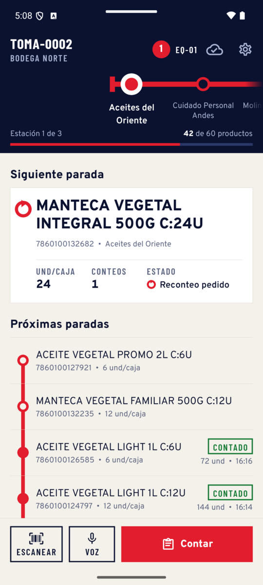
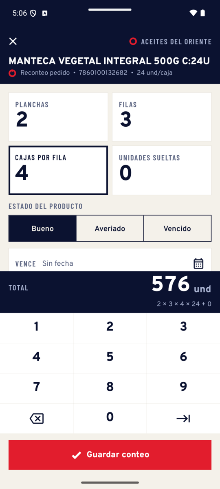
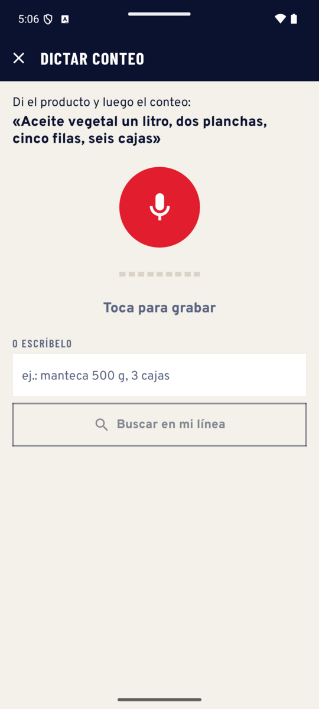
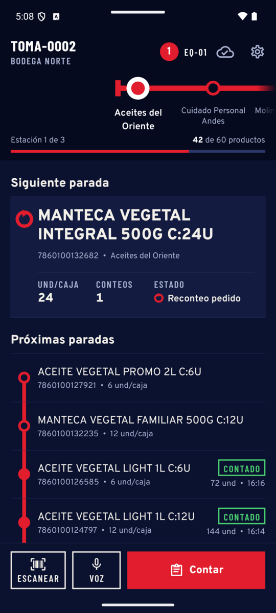
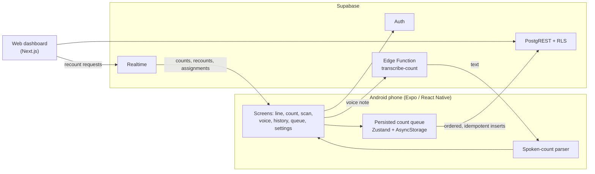

# Cuadre Mobile

**The counter's app for Cuadre, a live physical stock count for warehouses.**

This page gives an overview of a private repository. A code walkthrough is available on request.

Cuadre has two halves. Office staff watch the reconciliation on a web dashboard ([source on GitHub](https://github.com/EmeritusK/cuadre)). Counters walk the warehouse floor with this Android app and record what is physically on the shelf. Every count reaches the dashboard as soon as the phone has signal.

  
  
  
  

The screenshots use synthetic demo data. The interface is in Spanish (Ecuador), the language of its users.

## The problem

On count day, a warehouse worker counts hundreds of products while holding a phone in one hand. They often wear gloves, work in poor light, and have one bar of signal or none at the back of the building. Generic barcode inventory apps assume a desk, a stable network and one quantity field. These warehouses count stock in layers: pallets × rows × boxes per row × units per box, plus loose units. A count lost to a dropped connection means walking back to the shelf.

## What it does

- **Your line, not a list.** The team's suppliers are drawn as stations on a transit-style route strip, with the current station centred. Its products are stops on a vertical line, and the next stop to count is shown on top.
- **Counts the way the warehouse counts.** Fixed cells for planchas, filas, cajas and unidades sueltas, entered on a glove-sized keypad. The total and its formula stay pinned above the keypad while typing, so mistakes are caught on the floor. Each count also records the product condition (good, damaged, expired) and the expiry date.
- **Never loses a count.** Counts are saved on the phone first and sent in order once the backend is reachable. Each count carries a UUID generated on the phone as its row id, so a retry can never double a total. A cloud badge shows what is still waiting, and rejected counts can be retried or discarded.
- **Live.** Supabase Realtime refreshes the line when a teammate counts or a supervisor flags a recount from the web.
- **Scan or speak.** The counter can jump to a product by scanning its barcode, or dictate a count such as *"aceite vegetal un litro, dos planchas, cinco filas, seis cajas"*. The transcript is parsed on the phone, which understands Spanish number words and warehouse synonyms, and is matched against the counter's own products. The count sheet then opens prefilled.
- **Blind count.** The app never requests the system quantity or the cost, so counters cannot be anchored by the expected number.
- **Built for the aisle.** Light and dark themes, 48 dp touch targets, and status always shown as a glyph plus a word, never by colour alone. Layouts hold at 2× font size, and motion respects the system's reduce-motion setting.

## Architecture

- **Shared backend.** The app and the web dashboard use the same Supabase database. Row Level Security (`can_count()`) decides what a counter may count, and a trigger re-derives the organisation, session and units per box from the product, so the phone cannot send inconsistent data.
- **Server state and device state.** TanStack Query owns server state. Zustand, persisted with AsyncStorage, owns the offline queue and user preferences.
- **Sync engine.** A dedicated module sends the queue in order and retries until each count gets through. Because every row id is generated on the client, the database's primary key rejects duplicates.
- **Pure domain logic.** The count formula, es-EC number formatting and the spoken-count parser are plain TypeScript with no React, and they are unit-tested.
- **Scale.** A session holds 50 to 5,000 products. The line queries page past the 1,000-row PostgREST limit.

## Tech stack

| Layer | Technologies |
| --- | --- |
| App | Expo SDK 49, React Native 0.72, TypeScript (strict) |
| Navigation | React Navigation 6 (native stack) |
| State | TanStack Query, Zustand, AsyncStorage |
| Backend | Supabase: Auth, PostgREST with RLS, Realtime, Edge Functions |
| Device | expo-barcode-scanner, expo-av (voice capture), expo-haptics, NetInfo |
| Quality | Jest with jest-expo, ESLint, Prettier |

## Engineering

- About 5,800 lines of TypeScript, organised by layer: `api`, `domain`, `features`, `screens`, `state`, `sync`, `theme` and `ui`.
- 23 unit tests across 3 suites cover the count formula, queue ordering and the voice parser.
- The project started on Expo SDK 48 and was upgraded to SDK 49 during development.
- The history has 37 commits written as Conventional Commits.

## Author

**Jair Paredes** · [github.com/EmeritusK](https://github.com/EmeritusK)
